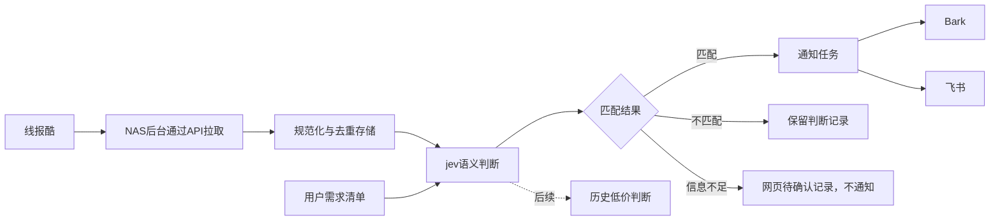

# 线报需求匹配与推送：技术设计

状态：用户已批准完整方案，当前暂缓实施。需求以prd.md的R1—R5为准；技术方案由本设计约束。

## 数据流

用户已确认Docker部署到本地NAS，首版同时实现Bark和飞书，并通过网页配置需求清单、jev、推送渠道与采集频道。默认采集官方API的全部开放频道。基于NAS环境，设计采用官方API拉取，所有对外服务请求从NAS发起，不把公网Webhook接收服务纳入首版。现有仓库没有业务代码，不预设已有技术栈。

## 网页配置后台

网页按以下最小管理行为实现，不增加第二套CLI配置工作流。

| 页面 | 第一版行为 |
| --- | --- |
| 需求清单 | 名称、可选自然语言备注；新增、编辑、启停、删除；不要求用户穷举品牌 |
| 采集配置 | 读取官方能力清单的开放频道；默认全部启用，用户可保存自定义选择；展示采集状态 |
| jev配置 | TypeSafe服务地址（默认https://api.typesafe.ai）、模型标识（默认jev-latest）、API密钥、调用超时；测试原生System One连接 |
| 推送渠道 | Bark地址/设备Key，飞书Webhook及可选签名/关键词前缀；分别启停、保存和测试发送 |
| 线报记录 | 原始标题与链接、匹配需求、分类与概率/置信度、程序模板说明、匹配/不匹配/待确认/处理失败状态 |
| 投递状态 | 查看每个渠道的接口结果与失败原因；只重试失败渠道 |

用户已确认单管理员密码登录，在本地NAS运行，局域网访问；不增加多租户、用户注册或权限角色系统。管理员凭据由部署配置设置，密码只保存安全哈希。配置与记录API、测试连接/发送、手动重试均在服务端检查会话，不能仅靠前端页面跳转阻止访问。

会话使用服务端可验证的HttpOnly Cookie并设置SameSite策略；退出登录清除会话。写操作验证同源请求，登录失败限速。局域网HTTP与反向代理HTTPS环境分别设置Cookie传输属性，不因强制HTTPS Cookie使NAS初次局域网部署无法登录。具体会话有效期作为实现配置，避免额外引入用户系统。

技术方案采用TypeScript + Next.js网页与服务端接口、SQLite持久化、独立后台任务进程；使用pnpm，Docker Compose编排。依赖版本在实现初始化时通过官方文档确认并锁定。采集/模型判断不能依赖浏览器一直打开，也不能只在处理网页请求时启动。

配置写入服务端并持久化；敏感字段用服务器密钥加密，编辑页面只显示已配置状态/掩码，空输入保留旧值，清除通过显式操作。读取配置不返回原始模型密钥或推送凭据；普通模型请求/推送只在后台服务发出。启动配置页之外还需服务端启动密钥与数据库路径，不假定所有基础运行参数都能安全地在网页引导。

网页保存配置后新任务使用新配置；进行中的任务记录使用的清单/模型配置版本，避免误认为已经按新设置处理。测试按钮只执行单次测试，不触发旧线报批量回放。

## 启动基线与新线报

用户已确认首次启动只处理之后的新线报。每个频道首次成功获取快照时，原子写入该频道基线状态和当前条目的来源ID集合；仅该快照中全局首次出现的来源记录标记baseline，不创建判断或通知任务。若记录已由另一频道入队、判断或通知，建立新频道基线不能覆盖其状态、降为baseline或取消已有任务。后续新增来源ID才进入正常处理；来源ID包含所属编号空间，跨频道重复文章仍按实际来源记录去重。

频道首次获取失败时不标记初始化完成，下一次成功取得的快照再建立基线；网页显示该频道正在初始化或失败，避免让用户误认为已经开始监控。

initialized状态、已见记录和未完成任务均持久化。容器重启沿用它们，不重新把所有频道基线化；处理已入队任务并继续获取停机后仍可见的新条目。停机超过快照窗口的数据无法完整补齐。

首次新启用一个未初始化频道沿用同样的基线规则。已初始化频道停用后再次启用则保留基线状态，继续处理当前仍可见且未见过的条目。清单修改只影响后续新任务，不自动回放旧线报。

## NAS部署设计

- 提供Docker Compose部署入口。同一镜像启动web与worker两个服务，分别负责网页/API与持续处理；只web发布局域网访问端口，worker不开放端口。
- 共用持久化数据目录，保存SQLite数据库、配置和任务记录；容器启动、重启与镜像升级均不重置配置。
- 服务端加密密钥保存在持久化配置或稳定的部署环境配置中，不能每次启动随机替换，备份与恢复必须同时包含数据库和对应密钥。
- worker通过数据库领取任务和保存检查点，采用互斥领取机制；容器重启后恢复未完成任务，web与worker不重复启动同一采集轮次。
- 线报API、jev、Bark与飞书均由NAS向外请求。网页只是管理入口，不参与后台是否运行的生命周期。
- 提供运行健康状态和最后采集/判断时间，便于区分“没有命中”与“后台失败”。
- 构建与发布时核验目标NAS架构，候选为amd64/arm64；当前尚未验证镜像或原生依赖对两种架构均可用。
- 启动端口、数据目录和基础管理员凭据属于部署配置；需求清单、Jev及通知渠道由网页维护。升级前备份数据；若有数据库迁移，不能承诺任意旧镜像直接读取新数据。

## 接入边界

- 网站已有公开 API 文档和自定义 Webhook；见 `research/xianbao-source.md`。
- 频道来源以官方 `/api/v1/meta` 当前能力清单为准，涵盖所有开放且可接入的线报流，不把网站导航里登录用户私有频道当作开放频道。
- 用户已选默认全部开放频道，并要求网页可选择。保存 `all` / `custom` 模式：all模式跟随能力清单；用户保存部分频道后用稳定频道标识存储自定义列表。新增频道在all模式自动纳入，在custom模式先不启用；开放频道撤下时显示不可用并停止该频道请求，不丢弃已存线报。
- 逐频道按缓存时间调度、限制采集与Jev并发，不能把每IP额度乘以频道数；不同频道单独记录成功时间与错误，某个频道失败不停止其他频道。
- 采用官方 `/api/v1/feed` 拉取：文档确认无需登录/密钥，有正文并支持按频道接入，也省去接收端对公网暴露的部署要求。先读 `/api/v1/meta` 确认参数，按 `meta.cache_ttl` 控制频率，429 按 `Retry-After` 退避。不用商品名关键词限定全部输入，以免漏掉品牌描述。
- 网站出站Webhook作为已调研备选，本地NAS首版不采用。若后续需要切换，再核验账号权限、接收服务与筛选范围。
- API文档建议分类流10秒轮询，但每个分类流只留最新20条、值得买30条，没有历史分页。全频道调度应保守遵守总请求预算并结合缓存时间；频道过多或高峰快照覆盖可能遗漏。榜单不能作为全量历史补齐，不承诺完整回溯，实际吞吐量与meta字段待接入验证。
- 一条输入统一成：来源、来源记录 ID、原始链接、标题、正文（可为空）、来源类别、发布时间、可选品牌/商城/价格及原始载荷。
- 站点频道和商品品类是不同概念，例如“微博线报”不是“抽纸”的品类。
- 价格缺失用 null；原文价格不代表券后实付金额。不从“9.9”等孤立数字强行认定最终价格。
- 值得买独立流与普通分类流使用各自适配器；不把站外商品 ID 与站内文章 ID 当成同一个编号空间。

## 需求清单

录入名称，例如“抽纸”，以及可选备注，例如“不要湿巾、不要求品牌”，支持新增/编辑/启停/删除。首版不另做品牌、规格、商城、排除项的复杂字段组合；自然语言备注传给Jev问题说明。

本期不要求用户为每个需求穷举品牌关键词。关键词可作为召回提示，不能把“不含抽纸二字”直接当成不匹配的硬筛选条件。

## TypeSafe Jev判断

用户已确认服务身份，采用`POST /v1/systemone`，请求`state`、`model`、`questions`，Bearer API密钥在服务端使用。官方协议证据见 `research/jev-api-compatibility.md`。首版不实现OpenAI聊天适配或额外生成模型。

输入state：线报标题、正文、可用商品类目/品牌/商城。每个启用需求构造一个Choice问题，其instructions明确需求名称和备注。questions的稳定内部ID映射回需求ID，不能指望问题键名被模型当成需求内容。一个请求可包含多项需求的问题，具体批量大小按官方限制与真实样例验证决定。

Choice criteria：`matched`表示现有内容明确符合需求及备注约束；`not_matched`表示明确不相关或违反约束；`uncertain`表示证据不足、仅品牌相关或无法确认约束。返回chosen choice、probabilities、confidence，程序验证答案类型与问题ID集合，禁止把未知choice当命中。

用户选择仅推送明确匹配，只有 `matched` 进入通知任务；`uncertain` 留在网页待确认，`not_matched` 只保存记录。真实置信度与概率分布可保存展示，但不能直接把模型置信度宣称为业务准确率。保守策略以真实样例验证并确定，不随意指定未经验证的阈值。

输出只包含分类及模型提供的概率/置信度，不要求生成商品名称、规格、原文摘录或理由。一条线报可命中多项需求，合成一条通知。原始商品描述直接使用标题和已存在的来源字段；说明采用程序模板，例如“该线报被Jev判为符合需求：抽纸”，明确标注分类说明，不虚构模型解释。

明确匹配需要已有标题、正文或具体商品类目能够支持用户需求，不因为出现关联品牌就命中。模型返回结构不合法或请求失败属于处理失败，不等同于信息不足，更不能发送匹配通知。

示例（示例内容，不是真实线报）：

| 用户需求 | 线报内容 | 建议结果 |
| --- | --- | --- |
| 抽纸 | 心相印超韧抽纸24包 | 匹配 |
| 抽纸 | 维达软抽家庭装 | 匹配；由软抽语义和正文支持 |
| 抽纸 | 心相印湿巾80片 | 不匹配 |
| 抽纸 | 心相印卷纸12卷 | 不匹配 |
| 抽纸 | 心相印9.9元，正文无商品信息 | 信息不足 |

Jev只负责结构化判断，程序验证返回结构与需求ID再决定通知。线报正文作为state数据提供，不让其改变questions中的系统判断规则。模型超时或输出不合法时记录失败并有限重试，不伪造命中或静默丢弃。

## 存储、去重和通知

- 保存需求、原始线报、模型判断与通知投递记录，便于检查误报/漏报。
- 同一来源记录 ID 去重；没有 ID 时使用规范化原始链接。不要仅用标题去重，以免合并不同商品。
- 判断记录按线报内容版本、清单版本、模型/问题规则版本识别复用；清单修改不自动重新判断旧条目。
- 首次快照仅建立基线，不历史回推；只有通知接口成功才标记投递成功，失败可重试。重复活动不同文章的跨文章合并不纳入首版，以免把不同优惠误合并。
- 用户已确认Bark配置一个设备、飞书配置一个群，独立启停，命中线报发送到所有已启用渠道；按需求指定渠道、多设备/多群管理不纳入首版。
- 两个渠道各有投递记录和重试状态。Bark成功后飞书失败，只重试飞书；渠道全部关闭时仍能采集并判断，但只记入网页记录。
- 通知内容包括命中需求、原始标题、分类说明、原始线报链接和明确存在的原文价格/条件。分类说明使用程序模板，不作为模型生成理由。Bark利用url参数跳转、group分组；用户已确认飞书使用群自定义机器人Webhook，富文本a节点提供链接。首版不做飞书应用或个人会话消息。证据见 `research/feishu-notifications.md`。
- 飞书签名由服务端按官方规则生成，HTTP200且业务code为0才记为接口成功；限流或瞬时失败有限重试，配置错误留在网页待处理。
- 在推送渠道支持幂等前，无法承诺网络超时情况下绝对零重复；至少避免本地任务重跑导致重复。

## 后续历史低价

本期只留原始数据和独立判断步骤，不实现历史导入或最低价逻辑。后续低价比较需要商品、规格、数量与价格条件对齐；单凭“抽纸”或“心相印”无法比较。历史来源、单价口径及优惠适用条件届时单独规划。

## 核心数据与层间契约

| 对象 | 关键字段与约束 |
| --- | --- |
| Need | 稳定ID、名称、备注、enabled、version；删除或停用后新任务不再取该项 |
| ChannelState | 稳定来源标识、开放/选中状态、initialized、最后成功/失败时间；all/custom与已见记录独立保存 |
| Bulletin | 来源编号空间、来源ID、原始URL、标题、正文、频道、发布时间、可选商品字段、payload/contentVersion、baseline状态；来源身份唯一 |
| Evaluation | Bulletin ID、Need ID及需求快照、配置/问题规则版本、Choice结果、probabilities/confidence、错误/重试状态 |
| Delivery | Bulletin及判断快照、bark/feishu、pending/sending/succeeded/failed/disabled、尝试次数、锁租约、业务结果与错误；同一线报判断批次及渠道唯一 |
| SecretConfig | 当前非敏感配置版本与加密凭据；客户端读取只获得configured状态，绝不回传明文或可还原掩码 |

外部返回先按unknown处理，由采集/Jev/通知适配器各自验证并规范化，网页不直接解析外部载荷。API、worker、数据库共享领域类型与状态转换；SQLite事务负责基线、任务领取和通知创建，避免先标完成再创建任务导致丢失。

持久化数据库存UTC时间与明确单位；显示按浏览器时区格式化。正文按文本渲染，不执行上游HTML。配置提交区分保留/替换/清除凭据；空值不是清除指令。测试操作返回清洗后的结果，不回传上游可能含凭据的完整请求/响应。

worker领取任务时使用事务与租约，崩溃后允许恢复；处理失败保留具体阶段与尝试次数。通知创建采用事务内唯一约束，已成功渠道不能被同一任务重新领取。配置变更后的新任务用新版本；已开始任务保留快照。删除需求不破坏历史判断中的需求快照。

## 规划状态与实施前核验

产品决策与完整方案已批准，当前按用户要求暂缓实施。实际meta返回、Jev正反例、通知端到端和NAS镜像架构尚未实测；后续实现中先核对边界协议，并在凭据可用时做真实连接验收。如果实际协议与本设计存在影响首版行为的差异，回到规划说明影响并更新，不能静默缩减频道或更换模型。
