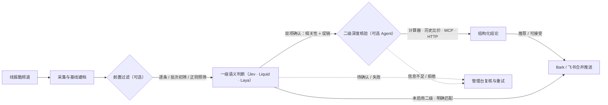

<div align="center">

# 双十一雷达 · Double11 Radar

**把购买需求交给 AI，让真正值得买的好价主动找到你。**

为双十一准备、也适合日常长期运行的自托管线报监控与智能筛选系统。<br/>
部署在 NAS 或轻量服务器上，持续采集线报酷，经「一级快速语义初筛 + 可选二级深度核验」后，将高价值命中推送至 Bark 与飞书群。

<p>
  
  
  
  
  
  
</p>

[工作流](#工作流) · [核心特性](#核心特性) · [快速部署](#1-快速部署docker-compose) · [管理台配置](#2-管理台配置顺序) · [本地开发](#3-本地开发) · [行为边界](#4-行为说明与边界) · [备份与运维](#5-备份升级与恢复)

</div>

---

## 工作流

填下像 `抽纸（只要原木浆、不要湿巾）` 这样的自然语言购买需求，关闭浏览器后独立后台 Worker 会持续采集、判断并投递通知。



> [!NOTE]
> **验证范围说明**：仓库包含完整的单元测试与集成测试，以及公开采集接口的实测逻辑；真实上游模型、Bark 与飞书的送达与匹配表现仍需在你的部署环境中自行验收。系统内的置信度分布与费用估算均作参考，不代表业务准确率或服务商实际账单。

---

## 核心特性

### 双级智能筛选与深度核验

| 能力 | 说明 |
| --- | --- |
| **一级决策引擎** | 兼容 TypeSafe Jev、Command Code、Liquid `d1.1` 及自建 Laya 等 SystemOne 协议端点；单条线报一次请求即可评估全部启用需求。 |
| **三种处理模式** | 支持**逐条判断**、**批次初筛**与**全局正则预筛**，在召回覆盖率与调用成本之间自由平衡。 |
| **双项匹配确认** | 每个需求同次评估「需求相关性」与「该商品促销有效性」，过滤纯晒单、收货体验、凑单提及与无优惠水帖。 |
| **二级深度核验（Agent）** | 可选对一级命中（及待确认）线报触发 OpenAI 兼容 LLM 二次核验，输出折后实付、单价公式、凑单步骤、历史比价与风险提示。 |
| **可插拔工具箱** | 二级 Agent 内置**精准价格/单价计算器**与**本地历史线报比价**，并支持扩展 **MCP Server** 与**自定义 HTTP API** 工具，附带跨请求熔断保护。 |

### 多渠道治理、密钥池与跨级账本

| 能力 | 说明 |
| --- | --- |
| **多渠道一键切换** | 自由新增、编辑、切换多个一级模型渠道（Base URL / 模型 / 超时），API 密钥池按渠道严格隔离。 |
| **密钥池容错与自愈** | 优先调度在途最少的 Key；连续失败自动停用并通过推送渠道发出脱敏告警，支持配置等待期后**定时自动重新启用**与恢复通知。 |
| **跨级用量与费用账本** | 统一统计一级与二级逐次调用、Token 消耗与估算费用；一级内置官方公布费率，二级支持 **OpenRouter 目录自动定价**、参考模型映射与手动单价覆盖。 |

### 可靠推送与自托管体验

| 能力 | 说明 |
| --- | --- |
| **双渠道合并推送** | Bark 与飞书群机器人（支持签名密钥与关键词前缀）独立启停、测试与重试；单条线报命中多个需求自动合并，跨频道同原文智能防重。 |
| **静谧工作室管理台** | Editorial Minimal 视觉体系，提供明暗双主题、左侧精简导航、移动端抽屉、需求分组管理、模拟需求试判与失败任务一键重试。 |
| **存储生命周期管理** | SQLite（WAL）本地持久化 + AES-256-GCM 凭据加密；提供空间占用看板、历史线报按天自动清理与一键 `VACUUM` 空间回收。 |

---

## 1. 快速部署（Docker Compose）

适合部署在群晖 / 飞牛 / Unraid / 任意 Linux 服务器上，Web 与 Worker 共享同一镜像与本地数据卷，**无需开放任何入站回调端口**。

```sh
git clone https://github.com/zhexin233-ui/double11-radar.git
cd double11-radar
cp .env.example .env

# 1. 生成 32 字节 base64 加密密钥，填入 .env 的 APP_ENCRYPTION_KEY
openssl rand -base64 32

# 2. 编辑 .env，设置 ADMIN_PASSWORD（管理员登录密码）
# 可选：核对将被保存的 scrypt 哈希
pnpm install && pnpm admin:hash

# 3. 构建并启动服务
docker compose up -d --build
docker compose ps            # 确认 web 状态为 healthy
docker compose logs -f worker
```

启动完成后，浏览器访问 `http://<NAS-IP>:3000`，使用 `ADMIN_PASSWORD` 登录管理台。

> [!TIP]
> **关于 pnpm 版本固定**：`package.json` 已固定 `packageManager: pnpm@10.13.1`。容器构建时 corepack 会按该版本安装，避免自动拉取新版 pnpm 触发 `minimumReleaseAge` 供应链策略而拒绝新发布的传递依赖。

### 环境变量

| 变量 | 必需 | 默认值 | 说明 |
| --- | :---: | --- | --- |
| `APP_ENCRYPTION_KEY` | 是 | — | Base64 编码的 32 字节密钥，用于 AES-256-GCM 加密模型密钥与推送凭据。**必须长期保持不变**，否则已存凭据无法解密。 |
| `ADMIN_PASSWORD` | 是 | — | 管理员登录密码。明文仅用于部署配置，数据库仅保存 scrypt 哈希。 |
| `DATA_DIR` | 否 | `/data` | 持久化目录，SQLite 数据库位于 `$DATA_DIR/xianbao.db`。 |
| `COOKIE_SECURE` | 否 | `false` | 局域网 HTTP 部署保持 `false`；经反向代理启用 HTTPS 后设为 `true`。 |
| `PORT` | 否 | `3000` | 宿主机对外发布端口（仅影响端口映射左侧，容器内固定监听 `3000`）。 |
| `XIANBAO_API_BASE` | 否 | `https://new.xianbao.fun` | 线报酷 API 基地址。 |
| `JEV_PROXY_URL` | 否 | 空（直连） | 一级模型请求专用 HTTP/HTTPS CONNECT 代理（如 `http://代理地址:端口`）。不支持内嵌认证信息，配置异常或代理故障不会静默回落直连；大型明文 HTTP 请求会自动分段发送以提升代理兼容性。 |

> [!IMPORTANT]
> `web` 与 `worker` 必须使用**完全一致**的 `DATA_DIR`、`APP_ENCRYPTION_KEY` 与 `ADMIN_PASSWORD`。默认的 `docker-compose.yml` 已通过共享 `.env` 和同一数据卷确保一致性。

---

## 2. 管理台配置顺序

登录管理台后，建议按以下顺序完成初始化配置：

1. **模型配置**（6 个管理标签页）
   - **连接与调度**：查看并测试当前活动渠道，支持多渠道新增、编辑、删除与一键切换，以及配置全局并发与每轮任务预算。
   - **判断模式**：在「逐条判断」「批次初筛」「正则预筛后逐条判断」之间切换。
   - **API 密钥**：按渠道隔离管理 Key 池、健康状态、连续失败自动停用与定时自动重新启用策略。
   - **费用与用量**：统一查看一级与二级调用账本，支持按核验级别、模型与渠道筛选 Token 消耗和估算费用。
   - **需求试判**：支持输入自定义模拟需求，在库内暂无启用需求时也能直接调试语义识别效果。
   - **二级核验与工具**（可选）：启用 OpenAI 兼容 LLM 二级核验，配置 OpenRouter 目录同步或手动单价，并管理内置计算器、本地历史比价、MCP Server 与自定义 HTTP 工具。
2. **采集频道**：默认勾选全部开放频道，也可按需精简；每个频道首次成功拉取仅建立基线，不推送历史旧帖。
3. **需求清单**：创建需求分组与具体购买需求（名称 + 约束备注），支持一键启停与弹窗批量整理。
4. **推送渠道**：配置 Bark（服务地址 + 设备 Key）与/或飞书群机器人 Webhook（可选加签密钥与关键词前缀），分别启停并发送测试消息。
5. **存储设置**：查看数据库总占用（主库 / WAL / SHM）与各表行数，设置历史线报保留天数、仅清理未命中策略，或手动触发清理与 `VACUUM`。
6. **线报记录**：按状态筛选（全部 / 等待判断 / 明确匹配 / 待确认 / 处理失败 / 没有匹配），支持分页浏览、单条详情追溯（含二级核验结论与手动触发深度核验）及可选 5 秒自动刷新。
7. **运行状态**：确认 Worker 心跳正常、各频道基线就绪、系统告警通道正常；若有历史失败任务，可直接一键重试。

> [!NOTE]
> **凭据安全机制**：所有 API Key 与推送密钥均采用三态编辑（**保留原值 / 替换 / 清除**），留空提交不会误清空现有凭据；界面读取仅返回脱敏掩码，绝不回传明文。

---

## 3. 本地开发

环境要求：`Node.js >= 22`、`pnpm 10.x`（推荐使用 `corepack enable`）。

```sh
pnpm install
cp .env.example .env            # 至少填写 APP_ENCRYPTION_KEY 与 ADMIN_PASSWORD
export DATA_DIR=$PWD/data       # 开发时避免写入系统根目录 /data

pnpm dev                        # 启动 Next.js 管理台与 API（默认 3000 端口）
pnpm worker                     # 另开终端启动独立后台 Worker
```

### 质量门禁

```sh
pnpm lint                       # ESLint 检查
pnpm typecheck                  # TypeScript 类型检查
pnpm test                       # Vitest 自动化测试
pnpm build                      # Next.js 生产构建
docker compose config           # 校验 Compose 配置
docker compose build            # 校验 Docker 镜像构建
```

---

## 4. 行为说明与边界

系统在设计上优先保证**低误报、不静默丢数据、失败可观测与重启可恢复**。以下为关键运行规则（点击展开查看细节）：

<details>
<summary><strong>采集基线、跨频道去重与上游限流策略</strong></summary>

- **首次基线**：每个频道首次成功抓取到的快照只记为基线，不调用模型、不推送；之后新出现的线报才进入判断流程。容器重启会沿用持久化基线与队列，不会回推旧消息。
- **跨频道防重**：各频道保留独立的采集与判断记录，但普通流中同一原文按推送渠道仅安排一次投递；值得买独立流（`type=zdm`）保留独立编号空间，避免与分类流 `zhidemai` 重复采集。
- **分类校验**：采集使用上游数字分类 ID；若上游返回全站或错误分类内容，会中止本轮并记录错误，不污染频道数据。
- **限流保护**：线报酷官方限制为 60 次/分钟/IP/接口（分类流最新 20 条、值得买 30 条，无历史分页）。本应用稳态目标仅占一半额度（30 次/分钟），频道间隔取 `max(cache_ttl, ceil(60 × 频道数 / 30))` 秒，轮内请求间隔 1.2 秒；当响应头剩余额度 ≤ 5 时自动全局暂停至窗口重置。**请勿在同一出口 IP 下并行运行多个采集实例。** 长时间停机或高峰期仍可能遗漏，不承诺补齐完整历史。

</details>

<details>
<summary><strong>一级双项确认语义、吞吐与容错机制</strong></summary>

- **判断三态与失败隔离**：`matched` 进入推送（或二级核验）；`uncertain` 留在管理台待确认；`not_matched` 仅落库记录。调用异常或结构非法记为「处理失败」，与「没有匹配」严格区分，绝不伪造成命中。
- **双项确认（`systemone-need-offer-v3`）**：对 N 个启用需求同次发起 2N 题（`need_<id>` 需求相关性 + `offer_<id>` 该商品促销信息），仍仅消耗 1 次请求。两题均判定为 `matched` 且概率分布合法占优时确认命中；促销报价、优惠券、折扣与试用可作为有效证据，纯晒单、收货体验、售后或仅凑单提及的目标商品不会被误判为促销。
- **配置错误可恢复**：未配置模型或密钥失效时，任务不会直接判死，而是保持待处理并按 5 分钟间隔重排；修复凭据后自动恢复判断。
- **限流与密钥自愈**：429/529 严格遵守 `Retry-After` 并触发全池共享退避；连续失败的 Key 会自动停用并发出脱敏渠道告警，配置自动重启用后会在等待期结束自动恢复参与调度。全局并发上限由调度参数控制，不随 Key 数量翻倍。
- **上下文边界**：TypeSafe Jev 官方限制为 64k（state + 全部问题）与 32k（state + 单题）；系统保留完整线报文本、不做静默截断，超限时明确记录失败原因。

</details>

<details>
<summary><strong>二级深度核验、工具熔断与跨级计费说明</strong></summary>

- **触发与降级**：二级核验默认关闭，开启后仅对一级已命中（及可选待确认）线报执行，避免无谓消耗通用 LLM Token。若二级调用异常或超时，可配置自动降级为一级原文推送并附带人工核对提示。
- **输出与决策**：二级 Agent 通过结构化 JSON 输出 `recommended` / `acceptable` / `rejected` / `insufficient_info` 四态结论；仅前两态（及可选 `insufficient_info`）触发通知，并将折后单价、凑单步骤与历史比价摘要一并写入推送卡片。
- **工具安全与熔断**：所有工具（内置计算器、本地历史查询、MCP Server、自定义 HTTP API）统一受跨请求熔断器保护；外部工具凭据加密存储，响应体自动截断限长。
- **计费精度**：一级按响应实际模型与官方公布费率估算（支持 TypeSafe Jev、Command Code、Liquid `d1.1`）；二级优先采用手填单价（按输入/输出独立覆盖，支持填 `0` 表示免费），其次直连 OpenRouter 时按完整模型 ID 精确匹配目录价，或通过显式参考模型 ID 映射。所有费用均以整数纳美元累计，未知单价明确标注「费用未知」，绝不伪装成 `$0.00`。

</details>

<details>
<summary><strong>投递保障与当前非目标（Non-Goals）</strong></summary>

- **独立投递与重试**：Bark 与飞书状态独立，单渠道失败仅重试该渠道，不重放已成功渠道。飞书需同时满足 HTTP 200 与业务 `code === 0`；错误码 `19021 / 19022 / 19024` 视为配置错误，自动停止重试并在界面提示。
- **防重与清理隔离**：通知防重台账长期保留，不随历史线报清理被删除；自动清理会跳过仍在排队或重试中的投递。
- **网络未知态**：请求超时属于未知状态并允许重试，因此无法保证极端网络抖动下的绝对零重复。
- **暂不包含**：自动下单、历史线报全量回放、飞书应用/个人私聊消息、多管理员账号体系、跨帖子拼单活动合并。

</details>

---

## 5. 备份、升级与恢复

> [!CAUTION]
> 备份时必须**同时保存数据目录与 `APP_ENCRYPTION_KEY`**，缺一不可。丢失加密密钥将导致数据库内所有已加密的 API Key 与推送凭据无法解密。

```sh
# 暂停写入服务后，完整备份数据目录（包含 SQLite 主库与 WAL 文件）
docker compose stop web worker
docker compose cp web:/data "../double11-radar-backup-$(date +%Y%m%d-%H%M%S)"
docker compose start web worker
```

- **恢复**：将数据目录还原到目标 `DATA_DIR`，并使用**同一个** `APP_ENCRYPTION_KEY` 启动服务。
- **升级**：建议升级前先执行上述备份。数据库迁移在 `BEGIN IMMEDIATE` 事务内幂等串行执行，支持平滑向前升级。
- **回滚**：旧版本镜像不保证兼容新版本迁移后的表结构，如需回滚，请同时恢复对应版本的数据库备份与加密密钥。

---

## 6. 常见问题排查

| 现象 | 排查建议 |
| --- | --- |
| 运行状态提示「处理故障」 | 执行 `docker compose logs -f worker` 检查后台日志，确认 Worker 心跳在 2 分钟内；历史遗留失败任务可在运行状态页直接点击重试。 |
| 频道出现采集错误 | 查看错误详情；触发 429 会自动退避，单频道故障已做隔离，不会阻塞其他频道。 |
| 线报持续「处理失败」 | 检查活动模型渠道地址、API 密钥状态及代理连通性；「处理失败」不会伪装为「没有匹配」。 |
| 收到「模型密钥已自动停用」告警 | 说明该 Key 连续多次请求失败（认证 / 限流 / 上游异常）；请检查额度与网络，或等待自动重启用，也可在密钥池手动恢复。 |
| 直接请求管理 API 返回 401 | 属预期行为：除 `/api/health` 外，所有配置、记录、试判与重试接口均要求登录会话。 |

---

## 7. 技术栈与架构概览

- **前端与服务端**：Next.js 16（App Router）+ React 19 + TypeScript 5.9 + Mantine 9
- **数据存储**：SQLite（`better-sqlite3` + WAL 模式）持久化配置、线报、评估、二级核验、调用账本与投递状态
- **后台进程**：独立 Node.js Worker（`src/worker/main.ts`），基于事务租约调度采集 → 预筛 → 一级判断 → 二级深度核验 → 推送投递，崩溃可自恢复
- **安全设计**：凭据使用 AES-256-GCM 加密落库；登录会话采用服务端可验证的 HttpOnly Cookie；全链路仅由 NAS 主动出站请求，无需公网入站回调

---

## 8. 反馈、免责声明与致谢

- 使用中遇到问题或有功能建议，欢迎提交 [GitHub Issue](https://github.com/zhexin233-ui/double11-radar/issues)。反馈时请附上部署方式、复现步骤与脱敏日志，**切勿上传 `.env`、API Key、Webhook 或数据库文件**。
- 本项目为个人开源工具，与线报酷、TypeSafe Jev、Liquid、OpenRouter、Bark、飞书无任何隶属关系。
- 感谢 [LINUX DO](https://linux.do/) 社区的支持与交流。
